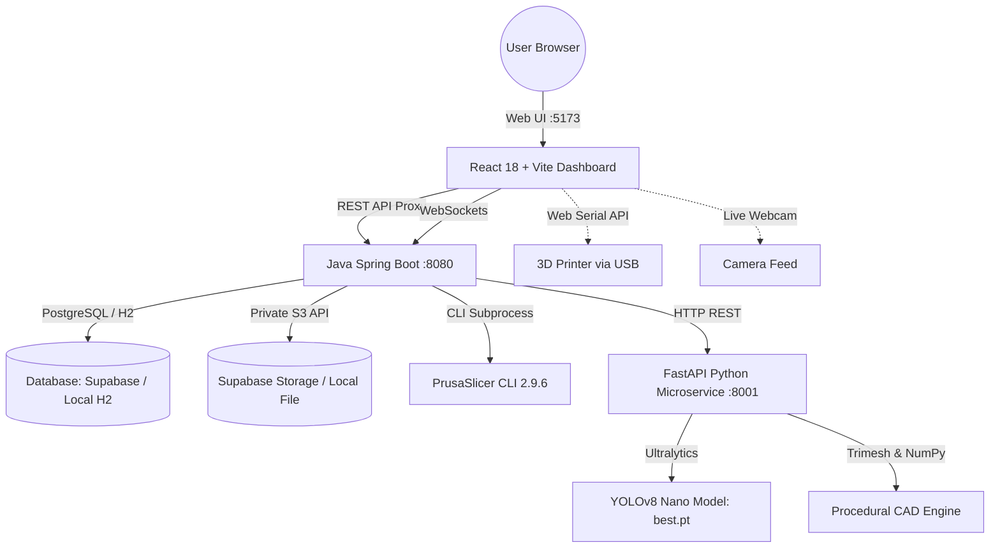

# PrintGuard AI — AI-Enhanced 3D Printing Platform 🚀

[](https://github.com/Warcraft433/AI_3D_Printer/actions/workflows/ci.yml)
[](https://opensource.org/licenses/MIT)
[](https://react.dev/)
[](https://spring.io/projects/spring-boot)
[](https://ultralytics.com/)
[](https://www.prusa3d.com/prusaslicer/)
[](http://localhost:8080/swagger-ui.html)

**PrintGuard AI** is an enterprise-ready intelligent additive manufacturing ecosystem combining **procedural & AI 3D model generation**, automated **G-code slicing**, direct hardware control, and real-time **computer vision defect detection** (spaghetti failure detection) to safeguard 3D print jobs.

---

## ✨ Enterprise Features

- 👁️ **Real-Time Defect Detection**: YOLOv8 computer vision model running inference over browser webcam feeds to detect print failure (spaghetti error) and trigger emergency pauses.
- ♟️ **Parametric & Procedural 3D CAD**: Integrated procedural geometry generator for watertight, manifold 3D meshes (e.g. Staunton chess collection).
- 🛠️ **Native PrusaSlicer Integration**: Headless CLI G-code slicing directly from STL/OBJ with real-time progress reporting.
- 🛡️ **Fault Tolerance & Resilience (Resilience4j)**: Integrated `@CircuitBreaker`, `@Retry`, and `@RateLimiter` guarding AI inference bridge and external slicing processes with graceful fallbacks.
- ⚡ **Asynchronous Event-Driven Architecture**: Non-blocking `ModelUploadedEvent` processing using Spring `@Async` custom thread pools with real-time WebSocket job telemetry (`/ws/jobs`).
- 🚀 **High-Performance Caching (Spring Data Redis)**: Distributed Redis cache with TTL-based eviction policies and seamless in-memory fallback for dashboard metrics, model metadata, and user preferences.
- 📖 **Interactive OpenAPI 3.0 Portal**: Self-documenting Swagger UI ([http://localhost:8080/swagger-ui.html](http://localhost:8080/swagger-ui.html)) with interactive JWT Bearer authorization schemes.
- 🔒 **Enterprise Security & Token Rotation**: Stateless JWT + Argon2 password hashing, Refresh Token Family Rotation with automatic reuse-theft detection, and OAuth2 client readiness.
- 🧪 **Production-Grade Testcontainers**: Ephemeral PostgreSQL container integration tests verifying Flyway database schema, migrations, and repository constraints.
- 📊 **Interactive 3D Visualizer & G-code Previewer**: Three.js / React Three Fiber layer-by-layer G-code inspection in the browser.
- 🕹️ **Printer Control & Telemetry**: OctoPrint API integration and direct browser-to-printer Web Serial API (`navigator.serial`) USB terminal.
- 🔄 **Continuous Integration (GitHub Actions)**: Automated multi-job CI pipeline verifying Java 21, Python Pytest, and Docker Compose builds.

---

## 🏗️ System Architecture



---

## 🚀 Quick Start (Local Showcase)

The project includes a 1-click launcher that frees ports, boots all 3 services, synchronizes health checks, and opens your browser:

### 1. Prerequisites
- **Node.js**: v20+ and npm
- **Java JDK**: 21+ and Apache Maven 3.9+
- **Python**: 3.11+ (virtual environment provided in `venv/`)

### 2. Start Everything with One Click
Double-click:
```cmd
run_showcase.bat
```
*(or run `.\run_showcase.bat` in Command Prompt / PowerShell)*

Once synchronized, your browser will open to:
* **Web UI (Frontend):** [http://localhost:5173](http://localhost:5173)
* **Interactive Swagger UI:** [http://localhost:8080/swagger-ui.html](http://localhost:8080/swagger-ui.html)
* **Spring Boot API Health:** [http://localhost:8080/api/health](http://localhost:8080/api/health)
* **AI Microservice Health:** [http://127.0.0.1:8001/api/inference/health](http://127.0.0.1:8001/api/inference/health)

### 3. Default Login Credentials
* **Username:** `admin`
* **Password:** `admin123`
*(Or use the **Register** tab to create a new local account)*

### 4. Stopping Services
Press **`[Q]`** in the showcase terminal window, or double-click:
```cmd
stop_showcase.bat
```

---

## 📁 Repository Structure

```text
AI_3D_Printer/
├── README.md                          # Master project documentation
├── .env                               # Local secrets & database configuration (protected)
├── .env.example                       # Verified template with environment placeholders
├── docker-compose.yml                 # Multi-container orchestration
├── run_showcase.bat                   # 1-Click Windows showcase launcher
├── stop_showcase.bat                  # 1-Click shutdown & port cleaner
│
├── frontend/                          # React 18 + Vite + TailwindCSS Web Application
│   ├── src/
│   │   ├── components/                # Glassmorphism UI, 3D viewers, webcam monitor
│   │   ├── context/                   # Auth, Generation, and Web Serial printer contexts
│   │   ├── pages/                     # Dashboard, AI Monitoring, G-code preview, etc.
│   │   └── services/api.js            # Axios & WebSocket client
│   └── package.json
│
├── backend-java/                      # Spring Boot 3.5.6 REST & WebSocket API
│   ├── pom.xml                        # Maven dependencies & build configuration
│   ├── Dockerfile                     # Multi-stage production container
│   ├── src/main/java/com/printguard/  # Controllers, services, JPA repositories, security
│   ├── src/main/resources/            # Application profiles (local, supabase, prod), Flyway SQL
│   └── src/test/                      # 75 passing unit & integration tests
│
├── ai-service/                        # Python FastAPI YOLOv8 Microservice
│   ├── app.py                         # Defect inference & procedural model API
│   ├── requirements.txt               # FastAPI, Uvicorn, Ultralytics, OpenCV
│   ├── test_ai_service.py             # 12 passing automated test suite
│   ├── Dockerfile
│   └── geometry/                      # Procedural 3D CAD generator (Trimesh / NumPy)
│
├── ai-model/                          # Machine Learning Model Weights
│   ├── best.pt                        # Active YOLOv8 nano defect detection weights
│   └── detect_test.py                 # Standalone YOLO inference verification
│
├── tools/                             # Host Executables
│   └── PrusaSlicer/                   # Extracted PrusaSlicer 2.9.6 CLI
│
├── media/                             # Local uploaded models, STL/OBJ files, and sliced G-code
│
├── scripts/                           # Operational Scripts
│   ├── development/                   # run_showcase.ps1, stop_showcase.ps1
│   ├── migration/                     # Schema and RLS database migration scripts
│   └── testing/                       # CAD and syntax validation scripts
│
├── docs/                              # Structured Documentation
│   ├── architecture/                  # System design, data flow, PostgreSQL/RLS specs
│   ├── api/                           # Endpoint specifications
│   ├── development/                   # Setup, training, and troubleshooting guides
│   └── reports/                       # Technical audit reports and prompt logs
│
├── tests/                             # System-level Integration Tests
│
└── legacy/                            # Preserved Historical Implementations
    ├── README.md                      # Legacy documentation & migration notes
    ├── backend-django/                # Original Django prototype and db.sqlite3
    ├── pi/                            # Deprecated Raspberry Pi scripts
    └── migration/                     # Data migration snapshots
```

---

## 🛠️ Testing & Quality Assurance

All services include automated test suites:

- **Backend (Java)**:
  ```powershell
  cd backend-java
  .\mvnw.cmd test
  ```
  *(85+ passing unit and integration tests covering JWT/Argon2 auth, token family rotation, Resilience4j circuit breakers, async events, Redis caching, OpenAPI specs, and Testcontainers)*

- **AI Microservice (Python)**:
  ```powershell
  cd ai-service
  pytest test_ai_service.py -v
  ```
  *(12 passing automated test suite covering health, frame defect detection, and procedural CAD geometry)*

- **Frontend (React)**:
  ```powershell
  cd frontend
  npm run build
  ```
  *(Production bundle builds with 0 errors)*

---

## 📄 License

Distributed under the MIT License. See [LICENSE](LICENSE) for more information.