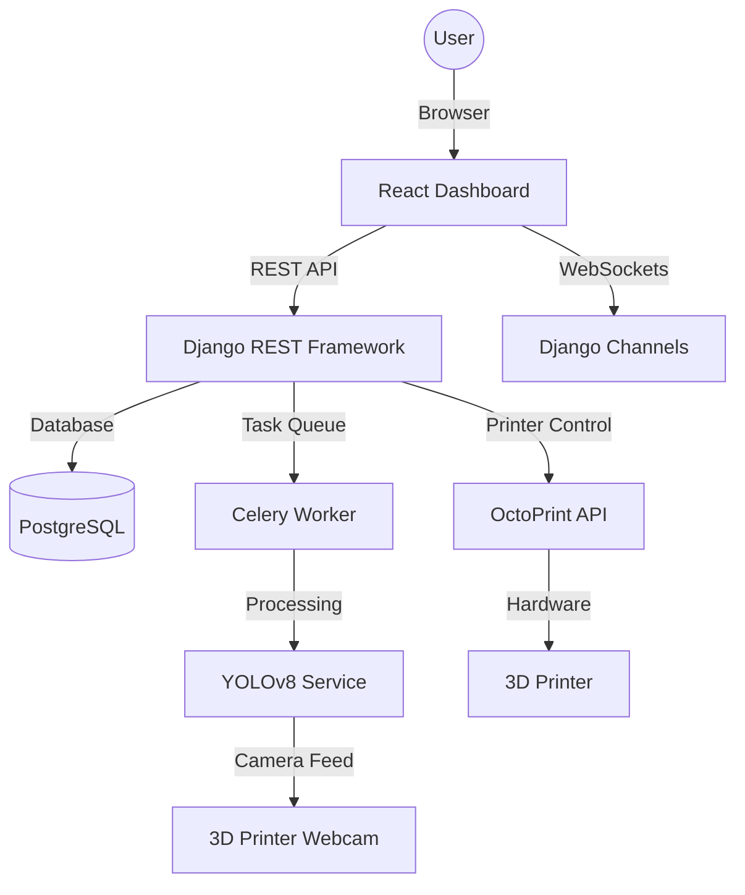

# AI-Integrated 3D Printer Dashboard 🚀


[](https://opensource.org/licenses/MIT)
[](https://github.com/your-username/ai-3d-printer/actions)
[](https://reactjs.org/)
[](https://www.djangoproject.com/)
[](https://ultralytics.com/)

An AI-powered smart 3D printing ecosystem that converts user prompts into printable 3D models and performs intelligent print monitoring with real-time defect detection and automatic hardware control.

---

## ✨ Features

- 🧠 **Prompt-to-3D Model Generation**: Uses OpenAI's Shap-E to convert text descriptions into high-quality 3D meshes.
- 👁️ **AI Defect Detection**: Real-time YOLOv8-based computer vision monitoring to detect spaghetti failures, warping, and layer shifts.
- 🕹️ **Printer Control**: Deep integration with OctoPrint API for telemetry monitoring and emergency pausing.
- 📊 **Futuristic Dashboard**: Glassmorphism UI with real-time Recharts analytics and live webcam streaming.
- 🛠️ **Smart Slicing**: Automatic G-code generation using integrated Slicer engines.
- 🐳 **Docker Ready**: One-click deployment using Docker Compose.

---

## 🏗️ Architecture



---

## 🚀 Quick Start

### 1. Prerequisites
- [Docker](https://www.docker.com/) & [Docker Compose](https://docs.docker.com/compose/)
- [Git](https://git-scm.com/)

### 2. Installation
```bash
git clone https://github.com/your-username/ai-3d-printer.git
cd ai-3d-printer
```

### 3. Setup Environment
Copy the example environment file and update your keys:
```bash
cp .env.example .env
```

### 4. Run with Docker
```bash
docker-compose up --build
```
The application will be available at `http://localhost:3000`.

---

## 💻 Local Development

### Windows
1. Run `setup.bat` to install dependencies and migrate the database.
2. Run `start.bat` to launch the frontend and backend servers.

### Linux / macOS
1. Run `./setup.sh`
2. Run `./start.sh`

---

## 📁 Project Structure

```text
├── frontend/           # React + Tailwind CSS + Recharts
├── backend/            # Django + DRF + Channels
├── ai-model/           # YOLOv8 weights and processing scripts
├── docs/               # Detailed documentation guides
├── docker/             # Dockerfiles and service configurations
├── scripts/            # Automation and deployment scripts
├── assets/             # Images, logos, and UI screenshots
├── sample-data/        # STL and G-CODE example files
├── tests/              # End-to-end and unit test suites
└── docker-compose.yml  # Multi-container orchestration
```

---

## 📚 Documentation

For detailed information, please refer to the following guides in the `docs/` folder:

- [Installation Guide](docs/installation.md)
- [API Reference](docs/api.md)
- [System Architecture](docs/architecture.md)
- [AI Model Training](docs/ai-model-training.md)
- [Troubleshooting](docs/troubleshooting.md)

---

## 🛠️ Tech Stack

- **Frontend**: React, Tailwind CSS, Recharts, Framer Motion, Lucide Icons.
- **Backend**: Django, Django REST Framework, Django Channels (WebSockets), Celery, Redis.
- **AI/ML**: YOLOv8, PyTorch, OpenCV, OpenAI Shap-E.
- **Database**: PostgreSQL (Production), SQLite (Dev).
- **DevOps**: Docker, Docker Compose, GitHub Actions (CI/CD).

---

## 🤝 Contributing

Contributions are what make the open source community such an amazing place to learn, inspire, and create. Any contributions you make are **greatly appreciated**.

Please see [CONTRIBUTING.md](CONTRIBUTING.md) for more details.

---

## 📄 License

Distributed under the MIT License. See `LICENSE` for more information.

---

## 🌟 Acknowledgements

- [Ultralytics](https://github.com/ultralytics/ultralytics) for YOLOv8.
- [OpenAI](https://github.com/openai/shap-e) for Shap-E.
- [OctoPrint](https://octoprint.org/) for the amazing printer interface.
