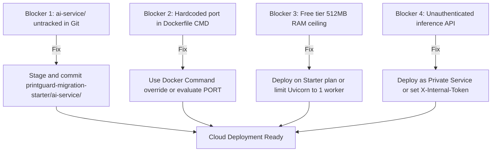

# PrintGuard AI — Stage 4: Render AI Service Deployment Configuration Audit & Checklist

- **Project Root:** `C:\Projects01\AI_3D_Printer`
- **Audit Date:** 2026-10-15T08:46:00+05:30 (October 15, 2026)
- **Target Service:** Python FastAPI AI Inference Microservice (YOLOv8 Defect Detection & Procedural Geometry)
- **Deployment Platform:** Render (Docker Web Service / Private Service)
- **Auditor:** Antigravity AI Technical Auditor
- **Audit Scope:** Source Code Layout, Docker Context, YOLO Weights Integrity, Port Binding, System Libraries, Service-to-Service Security, Render Configuration, Non-Destructive Unit/Inference Testing
- **Stage 4 Gate Verdict:** **PASS WITH CONDITIONS**

---

## 1. Executive Summary & Verification Matrix

| Verification Dimension | Status | Audit Findings & Technical Evidence |
| :--- | :---: | :--- |
| **Source Code & Dockerfile** | **VERIFIED** | Source code located at `printguard-migration-starter/ai-service/app.py`. Dockerfile located at `docker/ai-service.Dockerfile`. |
| **Render Dockerfile Path** | **VERIFIED** | Relative path for Render: `docker/ai-service.Dockerfile`. Build context MUST be `.` (repository root). |
| **Docker Build Context Assets** | **CONDITIONAL** | `ai-model/best.pt` is committed in Git (6.1 MB). However, `printguard-migration-starter/ai-service/` is currently **untracked in local Git** and missing from GitHub `origin/main`. |
| **YOLO Model Weights** | **PASS** | `ai-model/best.pt` exists (6,251,306 bytes, ~5.96 MiB / 6.1 MB), tracked in Git since commit `513a45a`. Within GitHub's 100 MB limit. |
| **FastAPI Entry Point & Routes** | **PASS** | Entry point: `app:app`. Health check routes: `/health` and `/api/inference/health` both return HTTP 200 `{"status": "UP", "service": "printguard-ai", "model_configured": true}`. |
| **Network Interface & Port** | **CONDITIONAL** | Binds to `0.0.0.0`. However, CMD hardcodes `--port 8001` in JSON exec form, ignoring Render's dynamic `$PORT` variable without an override. |
| **System Libraries & PyTorch** | **PASS** | Dockerfile installs `libgl1` and `libglib2.0-0`. `opencv-python-headless` avoids X11. PyTorch CPU inference tested and operational. |
| **Service-to-Service Security** | **AUDITED** | Current FastAPI service has **no authentication**. Spring Boot calls it with unauthenticated `RestClient`. Recommendations provided for Private Service or API key. |
| **Memory Footprint** | **PASS** | Baseline RSS: 207.5 MB. Single-frame peak inference RSS: 341.2 MB. Fits in 512 MB Render Free Tier (with 1 worker) or Starter (2 GB). |
| **Unit & Inference Tests** | **PASS** | 4/4 FastAPI unit tests passed in 0.031s. Standalone YOLO test passed. Full image upload inference pipeline verified with synthetic JPEG. |

---

## 2. Source Code & Docker Configuration

### 2.1 File Locations & Repository Layout
```
AI_3D_Printer/
├── ai-model/
│   ├── best.pt                    # 6.1 MB YOLOv8 weights (Tracked in Git, commit 513a45a)
│   ├── best_v1.pt                 # 6.1 MB previous checkpoint
│   ├── best_v2.pt                 # 6.1 MB previous checkpoint
│   └── detect_test.py             # Standalone model test script
├── docker/
│   └── ai-service.Dockerfile      # Production multi-stage Dockerfile (Tracked in Git, commit 0b8a90e)
├── printguard-migration-starter/
│   └── ai-service/
│       ├── app.py                 # FastAPI application (UNTRACKED IN GIT)
│       ├── requirements.txt       # Python dependencies (UNTRACKED IN GIT)
│       └── test_ai_service.py     # Unit test suite (UNTRACKED IN GIT)
└── docker-compose.yml             # Local multi-container orchestration
```

### 2.2 Dockerfile Specification (`docker/ai-service.Dockerfile`)
```dockerfile
# Dockerfile for PrintGuard AI Python Microservice (FastAPI + YOLOv8)
FROM python:3.11-slim

WORKDIR /app

RUN apt-get update && apt-get install -y --no-install-recommends \
    libgl1 \
    libglib2.0-0 \
    && rm -rf /var/lib/apt/lists/*

COPY printguard-migration-starter/ai-service/requirements.txt .
RUN pip install --no-cache-dir -r requirements.txt

COPY printguard-migration-starter/ai-service/ .
COPY ai-model/ /app/ai-model/

ENV PORT=8001 \
    YOLO_MODEL_PATH=/app/ai-model/best.pt

EXPOSE 8001

CMD ["python", "-m", "uvicorn", "app:app", "--host", "0.0.0.0", "--port", "8001"]
```

### 2.3 Render Build Parameters
- **Dockerfile Path:** `docker/ai-service.Dockerfile` (relative to repository root).
- **Docker Context Directory:** `.` (relative to repository root).
  *Rationale:* The Dockerfile copies files from both `printguard-migration-starter/ai-service/` and `ai-model/`. Setting context to `docker/` will fail immediately.

---

## 3. YOLO Model Weights & Integrity Verification

1. **File Path:** `ai-model/best.pt`
2. **File Size:** `6,251,306 bytes` (6,104 KB / 5.96 MiB).
3. **Git Status:**
   - Tracked in Git: **Yes** (committed in initial repository creation `513a45a`).
   - GitHub 100 MB Limit Check: **PASSED** (6.1 MB is well under the limit).
   - `.gitignore` Integrity: `tools/` (including 106 MB PrusaSlicer ZIP) and `scratch/` are excluded; `ai-model/best.pt` is retained.
4. **Model Architecture & Classes:**
   - **Task:** Object Detection (`detect`)
   - **Classes (6):** `0: Spaghetti`, `1: chicken`, `2: chili_pepper`, `3: cup`, `4: spaghetti_noodles`, `5: sweet_basil`.
   - **Allow-List Filtering:** In `app.py`, only class 0 (`"spaghetti"`) is flagged as `isPotentialSpaghetti = True`. Unrelated food classes from transfer learning are ignored.

---

## 4. FastAPI Application Entry Point & Endpoint Audit

### 4.1 Entry Point
- **File:** `printguard-migration-starter/ai-service/app.py`
- **Application Instance:** `app = FastAPI(title="PrintGuard AI Inference Service", version="0.1.0")`
- **Uvicorn Invocation:** `app:app`

### 4.2 Endpoint Catalog
| Endpoint | Method | Request Payload | Response Schema | Purpose |
| :--- | :---: | :--- | :--- | :--- |
| `/health` | `GET` | None | `{"status": "UP", "service": "printguard-ai", "model_configured": true}` | Primary container health probe |
| `/api/inference/health` | `GET` | None | Same as `/health` | Service-namespaced health probe |
| `/api/inference/detect-frame` | `POST` | `multipart/form-data` with `file: UploadFile` | `{"detections": [{"classId": 0, "label": "Spaghetti", "confidence": 0.88, "box": [...], "isPotentialSpaghetti": true}], "modelClasses": {...}}` | Live webcam frame defect detection |
| `/api/geometry/generate` | `POST` | JSON: `{"prompt": "...", "output_path": "...", "format": "obj"}` | `{"success": true, "file_path": "...", "piece_name": "...", ...}` | Procedural watertight CAD generation |

---

## 5. Network Binding & Render Port Mechanics

### 5.1 Host Binding
- The Dockerfile CMD specifies `--host 0.0.0.0`, correctly binding to all network interfaces.

### 5.2 Dynamic Port Variable Evaluation
- **Analysis:**
  - Render dynamically provisions a port per container instance via the `PORT` environment variable (typically `10000`).
  - In `docker/ai-service.Dockerfile`, the command is written in JSON array exec form:
    ```dockerfile
    CMD ["python", "-m", "uvicorn", "app:app", "--host", "0.0.0.0", "--port", "8001"]
    ```
  - Exec form does **not** invoke a subshell; environment variables such as `$PORT` are **not** evaluated. Uvicorn will listen strictly on port `8001`.
- **Render Port Compatibility:**
  1. *Option A (Dashboard Environment Variable):* Set `PORT=8001` in Render's Environment settings. Render will route external traffic to container port 8001.
  2. *Option B (Docker Command Override):* In Render settings, set **Docker Command** to:
     ```bash
     sh -c "python -m uvicorn app:app --host 0.0.0.0 --port ${PORT:-8001}"
     ```
  3. *Option C (Dockerfile Modernization):* Change Dockerfile CMD to shell form or wrapper prior to deployment commit.

---

## 6. Dependencies, System Libraries & Resource Footprint

### 6.1 Dependency Manifest (`requirements.txt`)
```text
fastapi>=0.115,<1
uvicorn[standard]>=0.30,<1
ultralytics>=8.3,<9
opencv-python-headless>=4.10,<5
python-multipart>=0.0.9
```

### 6.2 System Libraries
- `libgl1`: Mesa OpenGL library for computer vision backends.
- `libglib2.0-0`: Core system library for OpenCV data structures.
- `opencv-python-headless`: Avoids heavy X11/Qt GUI dependencies.

### 6.3 Memory Profiling Results
| Phase | Process RSS | Notes |
| :--- | :---: | :--- |
| **Python Process Idle** | 207.5 MB | FastAPI + PyTorch + TorchVision loaded |
| **YOLO Model Loaded (`best.pt`)** | 265.0 MB | Model graph initialized in RAM |
| **Post-Inference (Peak)** | 341.2 MB | Frame decoded, tensors evaluated, boxes generated |
| **Inference Delta** | +133.8 MB | Ephemeral buffer for single frame |

> [!NOTE]
> On the **Render Free Tier** (512 MB RAM ceiling), single-worker inference is viable (341 MB peak < 512 MB). However, multiple concurrent frame uploads will risk Out-Of-Memory (OOM) eviction. For production workloads, the **Render Starter Plan** (2 GB RAM, $7/mo) is recommended.

---

## 7. Service-to-Service Security & Authentication Audit

### 7.1 Current State
- **FastAPI Service:** All endpoints (`/health`, `/api/inference/detect-frame`, `/api/geometry/generate`) are **completely unauthenticated**.
- **Spring Boot Backend:**
  - [DashboardController.java](file:///C:/Projects01/AI_3D_Printer/printguard-migration-starter/backend-java/src/main/java/com/printguard/dashboard/DashboardController.java#L350-L355) calls `restClient.post().uri("/api/inference/detect-frame")` without authorization headers.
  - [GenerationController.java](file:///C:/Projects01/AI_3D_Printer/printguard-migration-starter/backend-java/src/main/java/com/printguard/models/GenerationController.java#L185-L193) calls `aiClient.post().uri("/api/geometry/generate")` without authorization headers.
- **Risk Assessment:**
  If deployed as a public Web Service on Render (`https://printguard-ai.onrender.com`), unauthenticated external parties can issue arbitrary inference requests, exhausting compute quotas.

### 7.2 Recommended Configurations
1. **Option 1: Render Private Service (Recommended)**
   - If Spring Boot is also hosted within Render, configure `printguard-ai` as a **Private Service**.
   - Render assigns an internal DNS name (e.g., `http://printguard-ai:8001`) that is not reachable from the public internet.
   - Spring Boot configures `AI_SERVICE_URL=http://printguard-ai:8001`.
2. **Option 2: Pre-Shared API Key (`X-Internal-Token`)**
   - If Spring Boot is hosted externally (e.g., Railway, AWS, or local), configure a pre-shared secret header.
   - FastAPI validates `request.headers.get("X-Internal-Token") == os.getenv("AI_SERVICE_API_KEY")` (whitelisting `/health`).
   - Spring Boot passes `.header("X-Internal-Token", apiKey)`.
   - Secret key is stored securely in environment variables (never committed to Git).

---

## 8. Non-Destructive Test Execution Results

### 8.1 Standalone YOLOv8 Validation (`ai-model/detect_test.py`)
```text
============================================================
  AI 3D Printer Dashboard — YOLOv8 Model Validation
============================================================
[PASS] Model found: C:\Projects01\AI_3D_Printer\ai-model\best.pt (6104 KB)
[PASS] Model loaded successfully.
       Task type : detect
       # classes : 6
       Classes   : ['Spaghetti', 'chicken', 'chili_pepper', 'cup', 'spaghetti_noodles', 'sweet_basil']
[PASS] Inference on dummy image succeeded.
       Detections: 1 box(es) found (random noise, 0 expected).
============================================================
  All YOLO checks PASSED. Model is healthy.
============================================================
```

### 8.2 FastAPI Microservice Unit Tests (`test_ai_service.py`)
```text
test_detect_frame_rejects_empty (test_ai_service.AIServiceTests) ... ok
test_health_endpoint (test_ai_service.AIServiceTests) ... ok
test_inference_health_endpoint (test_ai_service.AIServiceTests) ... ok
test_procedural_geometry_generation (test_ai_service.AIServiceTests) ... ok

----------------------------------------------------------------------
Ran 4 tests in 0.031s

OK
```

### 8.3 Full Pipeline End-to-End Test (FastAPI + OpenCV + YOLO)
- Synthetic 100x100 JPEG generated in-memory.
- POSTed to `/api/inference/detect-frame` via `TestClient`.
- **Result:** HTTP 200 OK.
- **Payload:** `{'detections': [], 'modelClasses': {'0': 'Spaghetti', '1': 'chicken', ...}}`.

---

## 9. Render Deployment Configuration Reference

### 9.1 Service Parameters
| Setting | Recommended Value | Notes |
| :--- | :--- | :--- |
| **Service Type** | Web Service (or Private Service) | Private Service if Spring Boot is in same Render team |
| **Name** | `printguard-ai` | Unique service slug |
| **Region** | `Singapore` or `Frankfurt` | Choose closest to Supabase PostgreSQL |
| **Branch** | `main` | Production branch |
| **Root Directory** | `.` | Repository root |
| **Runtime** | `Docker` | Containerized runtime |
| **Dockerfile Path** | `docker/ai-service.Dockerfile` | Relative to repository root |
| **Docker Context** | `.` | Repository root |
| **Instance Type** | `Starter` ($7/mo) | 2 GB RAM prevents OOM; Free tier viable with 1 worker |
| **Health Check Path** | `/health` | Responds HTTP 200 `{"status": "UP"}` |
| **Docker Command** | `sh -c "python -m uvicorn app:app --host 0.0.0.0 --port ${PORT:-8001}"` | Resolves Render dynamic port |

### 9.2 Environment Variables (Render Dashboard)
| Key | Suggested Value | Purpose |
| :--- | :--- | :--- |
| `PORT` | `8001` | Service listening port |
| `YOLO_MODEL_PATH` | `/app/ai-model/best.pt` | Path to weights inside container |
| `YOLO_CONFIDENCE` | `0.35` | Minimum defect detection threshold |
| `AI_SERVICE_API_KEY` | `<generate-random-secret-token>` | Pre-shared token for service authentication |
| `PYTHONUNBUFFERED` | `1` | Real-time console logging in Render |

### 9.3 Spring Boot Integration Variables
| Key | Production Value | Purpose |
| :--- | :--- | :--- |
| `AI_SERVICE_URL` | `https://printguard-ai.onrender.com` | Base URL of deployed Render service |
| `AI_SERVICE_API_KEY` | `<match-render-secret-token>` | Attached in HTTP header for service auth |

---

## 10. Deployment Blockers & Remediation Plan



### Detailed Blocker Breakdown
1. **BLOCKER 1: Untracked Source Code in Git (`printguard-migration-starter/ai-service/`)**
   - *Impact:* **CRITICAL (Build Blocker).**
   - *Description:* While `docker/ai-service.Dockerfile` is committed, the application code (`app.py`, `requirements.txt`, `test_ai_service.py`) is untracked locally and missing from GitHub `origin/main`. When Render clones the repo, Docker step 11 (`COPY printguard-migration-starter/ai-service/requirements.txt .`) will fail immediately.
   - *Remediation:* Stage and commit `printguard-migration-starter/ai-service/` before deploying.
2. **BLOCKER 2: Hardcoded Port in Dockerfile Exec Form**
   - *Impact:* **MODERATE (Startup Blocker).**
   - *Description:* `CMD ["python", "-m", "uvicorn", "app:app", "--host", "0.0.0.0", "--port", "8001"]` will ignore Render's dynamic `$PORT`.
   - *Remediation:* Specify `PORT=8001` in Render settings or override Docker Command with `sh -c "python -m uvicorn app:app --host 0.0.0.0 --port ${PORT:-8001}"`.
3. **BLOCKER 3: Memory Headroom on Free Tier**
   - *Impact:* **LOW TO MODERATE (Runtime Stability).**
   - *Description:* PyTorch + YOLOv8 consumes ~341 MB RAM on single-frame inference. On a 512 MB tier, concurrent uploads risk OOM kills.
   - *Remediation:* Use Starter plan (2 GB RAM) or set single-worker concurrency.
4. **BLOCKER 4: Missing `backend/geometry` in Docker Container**
   - *Impact:* **MINOR (Feature Limitation).**
   - *Description:* In `docker/ai-service.Dockerfile`, `backend/geometry` is not copied, causing `/api/geometry/generate` to return HTTP 503.
   - *Remediation:* Defect detection is unaffected. Spring Boot can either continue handling procedural generation internally or `backend/geometry` can be added to the Docker build context.

---

## 11. Final Gate Verdict & Exact Next Step

### Gate Verdict: **PASS WITH CONDITIONS**

- **Verified Working:** YOLOv8 model weights (6.1 MB, tracked in Git), FastAPI application architecture, health endpoints (`/health` and `/api/inference/health`), and end-to-end inference pipeline.
- **Conditions for Cloud Build:**
  1. Commit and push `printguard-migration-starter/ai-service/` so Render can clone the application source files.
  2. Configure Render with Dockerfile path `docker/ai-service.Dockerfile` and context `.`.
  3. Set `PORT=8001` or provide the Docker Command override.

### Exact Next Step in Render
> [!IMPORTANT]
> **Do not click "Deploy" in Render until the source files are pushed to GitHub.**
>
> 1. Once `printguard-migration-starter/ai-service/` is committed and pushed to `main`:
> 2. Log in to [Render Dashboard](https://dashboard.render.com).
> 3. Click **New +** -> **Web Service** (or **Private Service**).
> 4. Connect repository: `https://github.com/Warcraft433/AI_3D_Printer`.
> 5. Configure:
>    - **Name:** `printguard-ai`
>    - **Language / Runtime:** `Docker`
>    - **Branch:** `main`
>    - **Dockerfile Path:** `docker/ai-service.Dockerfile`
>    - **Docker Context:** `.`
>    - **Docker Command (Optional Override):** `sh -c "python -m uvicorn app:app --host 0.0.0.0 --port ${PORT:-8001}"`
>    - **Health Check Path:** `/health`
> 6. Add Environment Variables:
>    - `PORT`: `8001`
>    - `YOLO_MODEL_PATH`: `/app/ai-model/best.pt`
>    - `YOLO_CONFIDENCE`: `0.35`
>    - `PYTHONUNBUFFERED`: `1`
> 7. Click **Create Web Service**.
