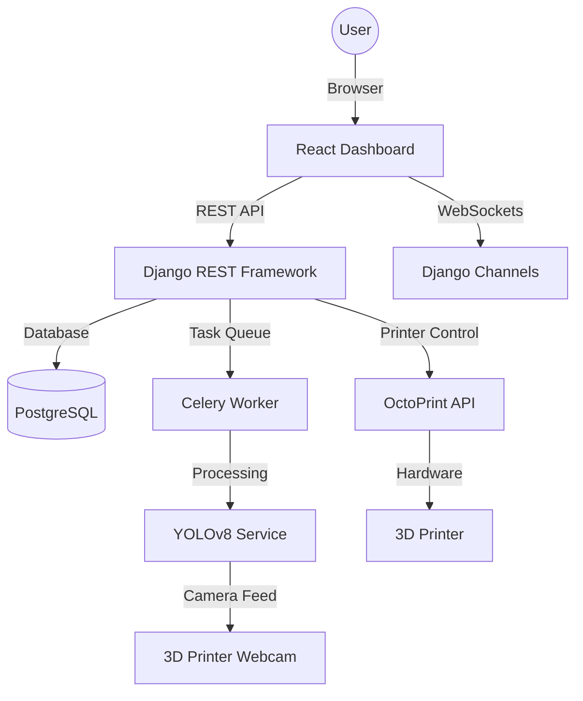

# System Architecture

The AI-Integrated 3D Printer system is designed with a modular architecture to ensure scalability and reliability.

## Overview Diagram

## Components

### 1. Frontend (React)
- **Tech:** React.js, Tailwind CSS, Recharts.
- **Role:** Providing a futuristic dashboard for monitoring and control. It communicates with the backend via REST and WebSockets.

### 2. Backend (Django)
- **Tech:** Django, DRF, Django Channels.
- **Role:** Managing data, authentication, and serving as a bridge between the frontend and the hardware/AI layers.

### 3. AI Service (YOLOv8)
- **Tech:** PyTorch, OpenCV, YOLOv8.
- **Role:** Real-time computer vision processing of the camera feed to detect print defects (spaghetti, warping, etc.).

### 4. 3D Printer Controller (OctoPrint)
- **Role:** Directly managing the 3D printer. Our system interacts with OctoPrint's API to fetch telemetry and send commands.

### 5. Task Orchestration (Celery & Redis)
- **Role:** Handling long-running tasks like 3D model generation and background AI monitoring loops without blocking the main API thread.
