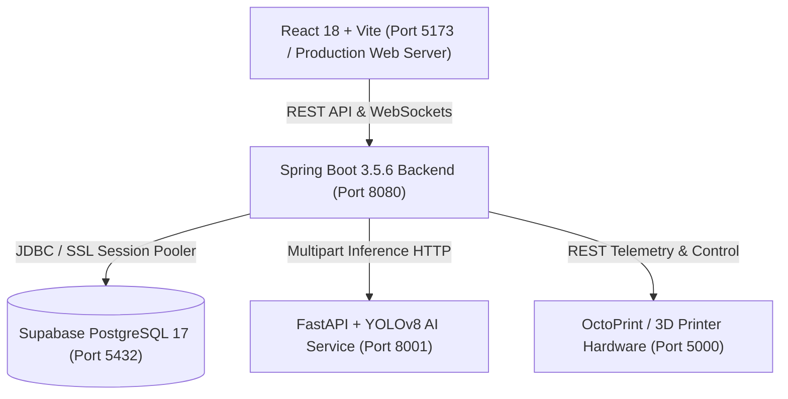

# PrintGuard AI — Production & Deployment Guide

This guide covers deploying, running, and operating the modernized **PrintGuard AI** microservice architecture.

---

## 1. System Architecture



### Components
1. **Frontend (`frontend/`):** React 18, Vite, Tailwind CSS, Lucide icons, Three.js 3D viewer.
2. **Backend (`printguard-migration-starter/backend-java/`):** Java 21, Spring Boot 3.5.6, Spring Security JWT, Spring Data JPA, Hibernate, WebSocket/STOMP.
3. **AI Microservice (`printguard-migration-starter/ai-service/`):** Python 3.11, FastAPI, OpenCV, Ultralytics YOLOv8 nano (`ai-model/best.pt`).
4. **Database:** Supabase PostgreSQL 17 (AWS `ap-south-1` Session Pooler on port 5432).
5. **Print Hardware (Optional):** OctoPrint server on port 5000 or Web Serial direct USB.

---

## 2. Environment Configuration

Copy `.env.example` to `.env` or set the variables in your hosting environment:

| Variable | Description | Example / Default |
|---|---|---|
| `PORT` | Spring Boot server port | `8080` |
| `SPRING_PROFILES_ACTIVE` | Active Spring profile | `supabase` (or `local`, `prod`) |
| `SPRING_DATASOURCE_URL` | PostgreSQL JDBC Connection URL | `jdbc:postgresql://aws-0-ap-south-1.pooler.supabase.com:5432/postgres?sslmode=require` |
| `SPRING_DATASOURCE_USERNAME` | PostgreSQL database user | `postgres.wlpskpsysnamtmzilpft` |
| `SPRING_DATASOURCE_PASSWORD` | PostgreSQL user password | `[REDACTED_SECRET]` |
| `AI_SERVICE_URL` | Microservice URL for defect inference | `http://127.0.0.1:8001` |
| `YOLO_CONFIDENCE` | Defect detection confidence threshold | `0.35` |
| `VITE_API_BASE_URL` | Frontend API base URL | `http://localhost:8080` (or empty for dev proxy) |
| `OCTOPRINT_URL` | Hardware link URL | `http://localhost:5000` |

> [!IMPORTANT]
> Keep `SPRING_DATASOURCE_PASSWORD` confidential. Never commit `.env` or hardcode credentials into Git.

---

## 3. Local & Host Deployment (Windows / Linux)

### Automated Unified Startup
To start all three services simultaneously on your local system:

- **Windows PowerShell:**
  ```powershell
  .\start_website.ps1
  ```
- **Windows Command Prompt:**
  ```cmd
  start.bat
  ```

Both launchers automatically detect `SPRING_DATASOURCE_PASSWORD` in your environment:
- If present, Spring Boot activates the **`supabase`** profile for persistent cloud PostgreSQL.
- If absent, it falls back to the **`local`** profile using an in-memory H2 database.

### Manual Service Startup

#### 1. Python AI Microservice
```powershell
cd printguard-migration-starter\ai-service
..\..\backend\venv\Scripts\python.exe -m uvicorn app:app --host 127.0.0.1 --port 8001
```
Health verification: `http://127.0.0.1:8001/health`

#### 2. Java Spring Boot Backend
```powershell
cd printguard-migration-starter\backend-java
$env:SPRING_DATASOURCE_PASSWORD = "your-database-password"
mvn spring-boot:run "-Dspring-boot.run.profiles=supabase"
```
Or run the packaged JAR:
```powershell
java -jar target\printguard-backend-0.1.0-SNAPSHOT.jar --spring.profiles.active=supabase
```
Health verification: `http://localhost:8080/actuator/health`

#### 3. React Vite Frontend
```powershell
cd frontend
npm run dev
```
Web application: `http://localhost:5173`

---

## 4. Containerized Deployment (Docker Compose)

For cloud hosts with Docker and Docker Compose installed:

```bash
# Build and start all containers
docker compose up -d --build

# View container logs
docker compose logs -f

# Stop all containers
docker compose down
```

### Docker Service Topology:
- **`ai-service`**: Containerized FastAPI YOLOv8 service on port `8001`.
- **`backend`**: Multi-stage Temurin 21 JRE image running Spring Boot on port `8080`.
- **`frontend`**: Node 18 runtime serving the Vite web application on port `5173`.
- **`db`**: (Optional) Local PostgreSQL 15 container if not using Supabase cloud.

---

## 5. Verification & Health Probes

Run these commands to verify each tier of the deployed system:

### 1. Spring Boot Health Probe
```bash
curl -s http://localhost:8080/actuator/health
# Expected: {"status":"UP","groups":["liveness","readiness"]}
```

### 2. AI Inference Microservice Probe
```bash
curl -s http://127.0.0.1:8001/health
# Expected: {"status":"UP","service":"printguard-ai","model_configured":true}
```

### 3. End-to-End Defect Detection Pipeline Probe
```bash
# Authenticate and obtain JWT
TOKEN=$(curl -s -X POST http://localhost:8080/api/auth/login/ \
  -H "Content-Type: application/json" \
  -d '{"username":"admin","password":"adminpassword123"}' | jq -r .access)

# Submit test frame
curl -s -X POST http://localhost:8080/api/dashboard/detect-frame/ \
  -H "Authorization: Bearer $TOKEN" \
  -F "frame=@backend/media/detections/defect_1.jpg"
# Expected: {"success":true,"defect_detected":true,"detections":[...]}
```

---

## 6. Operational Guardrails & Safety Notes

1. **Physical Hardware Disconnect Guardrail:**
   - When OctoPrint is unreachable at port 5000, the system reports `printer_connected: false` and `simulated: true`.
   - Starting a physical print returns HTTP 503 with `"hardware_confirmed": false` to prevent false positives.
2. **AI Model Fallback:**
   - In environments without GPU Shap-E, generative 3D requests automatically return a valid demo mesh and are tagged with `is_fallback: true` and `[DEMO FALLBACK]` in `error_detail`.
3. **Database Integrity:**
   - Production DDL mode is set to `validate` (`ddl-auto: validate`) to prevent accidental schema dropping or alteration on startup.
   - All schema changes must be applied through Flyway migrations in `db/migration/`.
