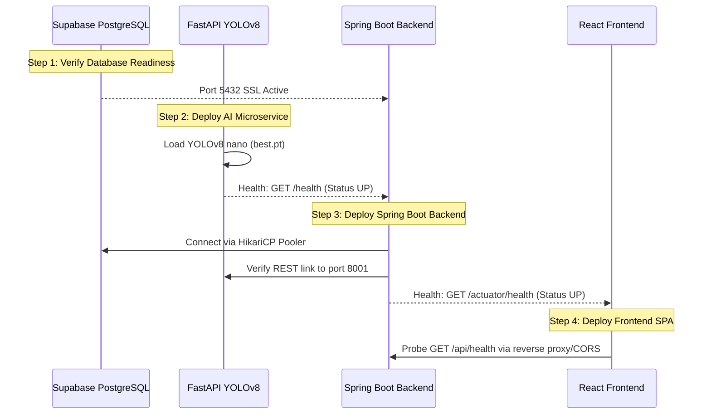

# PrintGuard AI — Production Deployment Plan

**Document Version:** 1.0.0  
**Target Architecture:** Microservices (React 18 + Spring Boot 3.5.6 + FastAPI YOLOv8 + Supabase PostgreSQL 17)  
**Target Profile:** Student / Capstone Project / Zero-to-Low Cost  

---

## 1. Executive Summary & Recommended Hosting Architecture

PrintGuard AI is a multi-tier AI-powered 3D printer monitoring and generative model platform. The system consists of four primary components:
1. **Frontend:** React 18 + Vite SPA with Three.js 3D visualization.
2. **Backend:** Java 21 + Spring Boot 3.5.6 REST API and WebSocket broker.
3. **AI Inference Service:** Python 3.11 + FastAPI + Ultralytics YOLOv8 nano defect detection.
4. **Database:** Cloud-managed Supabase PostgreSQL 17 (AWS `ap-south-1` Session Pooler).

### Recommended Architecture: Dual-Platform Strategy

To balance **zero cost**, **zero maintenance**, and **resource sufficiency**, we evaluate two deployment paths:

```
[Path A: Managed Multi-Cloud Free Tier (Recommended for Simplicity)]
 ┌────────────────┐          ┌───────────────────────┐          ┌───────────────────────┐
 │ Vercel / Pages │ ───────> │  Render Web Service   │ ───────> │  Supabase PostgreSQL  │
 │  (React SPA)   │  HTTPS   │  (Spring Boot / Java) │   SSL    │   (Cloud DB - Live)   │
 └────────────────┘          └───────────────────────┘          └───────────────────────┘
                                         │ HTTP
                                         ▼
                             ┌───────────────────────┐
                             │  Render Web Service   │
                             │ (FastAPI + YOLOv8)    │
                             └───────────────────────┘

[Path B: Single-Host Containerized VPS (Recommended for No Cold Starts)]
 ┌────────────────────────────────────────────────────────────────────────┐
 │ Oracle Cloud Always Free (4 OCPU, 24GB RAM) / $5 VPS                   │
 │                                                                        │
 │   Nginx Reverse Proxy + SSL (Certbot)                                  │
 │      ├── /               ──> printguard-frontend (Docker :5173)        │
 │      ├── /api, /media    ──> printguard-backend  (Docker :8080)        │
 │      └── /ws             ──> printguard-backend  (WebSocket :8080)     │
 │                                    ├── Supabase PostgreSQL (Remote)    │
 │                                    └── printguard-ai (Docker :8001)    │
 └────────────────────────────────────────────────────────────────────────┘
```

---

## 2. Service-by-Service Hosting Breakdown

| Service | Technology | Resource Footprint | Recommended Host | Free-Tier Feasibility & Constraints |
|---|---|---|---|---|
| **Frontend** | React 18, Vite 5, Tailwind CSS | Static assets (~1.8 MB bundle) | **Vercel** or **Cloudflare Pages** | **100% Free ($0/mo)**. Instant global CDN edge delivery, automatic HTTPS, zero cold starts, continuous deployment from Git. |
| **Backend** | Java 21, Spring Boot 3.5.6, Tomcat | ~350 MB – 450 MB RAM | **Render** (Free Web Service) or **Railway** ($5 credit) | **Free ($0/mo)** on Render. Constraint: 512 MB RAM limit (requires `-Xmx384m`), spins down after 15 min inactivity (~50s cold start). |
| **AI Service** | Python 3.11, FastAPI, YOLOv8 nano | ~300 MB – 400 MB RAM | **Render** (Free Web Service) or **Railway** | **Free ($0/mo)** on Render. CPU inference takes ~80–120ms per frame. *Note: OpenAI Shap-E GPU generation disabled; fallback demo mesh active.* |
| **Database** | PostgreSQL 17 with SSL | Remote cloud database | **Supabase** (Already Live) | **100% Free ($0/mo)**. 500 MB database, 50,000 MAU, connection pooling via port 5432. Preserved records already migrated. |
| **Media / Storage** | Files, 3D meshes, error snapshots | ~50 MB initial, growing | **Render Disk** ($1/mo) or **Supabase Storage** | Free tier PaaS ephemeral filesystems reset on redeploy. Use persistent volumes or Supabase Storage for long-term file durability. |

---

## 3. Required Environment Variables Specification

> [!IMPORTANT]
> Never commit actual passwords, tokens, or private URLs into version control. Set these values exclusively in your hosting provider's dashboard or secrets manager.

### A. Frontend Environment (`frontend/.env.production`)
| Variable | Description | Example Production Value |
|---|---|---|
| `VITE_API_BASE_URL` | Base URL for Spring Boot REST API | `https://printguard-backend.onrender.com/api` |
| `VITE_WS_URL` | WebSocket URL for real-time alerts & job telemetry | `wss://printguard-backend.onrender.com` |

### B. Spring Boot Backend Environment (Render / Railway / VPS)
| Variable | Description | Example Production Value |
|---|---|---|
| `PORT` | Spring Boot HTTP port | `8080` |
| `SPRING_PROFILES_ACTIVE` | Active Spring Boot profile | `supabase` |
| `SPRING_DATASOURCE_URL` | Supabase Session Pooler JDBC URL with SSL | `jdbc:postgresql://aws-0-ap-south-1.pooler.supabase.com:5432/postgres?sslmode=require` |
| `SPRING_DATASOURCE_USERNAME` | Supabase PostgreSQL user | `postgres.wlpskpsysnamtmzilpft` |
| `SPRING_DATASOURCE_PASSWORD` | Supabase database secret | `[SET_IN_PROVIDER_SECRETS]` |
| `AI_SERVICE_URL` | URL of the internal/deployed AI microservice | `https://printguard-ai.onrender.com` (or `http://ai-service:8001`) |
| `CORS_ALLOWED_ORIGINS` | Allowed frontend production origins | `https://printguard.vercel.app` |
| `JAVA_TOOL_OPTIONS` | JVM memory cap for 512MB RAM containers | `-Xms256m -Xmx384m -XX:+UseG1GC` |
| `MEDIA_DIR` | Absolute path for model files & defect snapshots | `/app/media` (or persistent mount) |

### C. Python AI Microservice Environment
| Variable | Description | Example Production Value |
|---|---|---|
| `PORT` | FastAPI uvicorn port | `8001` |
| `YOLO_MODEL_PATH` | Path to trained weights file | `ai-model/best.pt` |
| `YOLO_CONFIDENCE` | Confidence threshold for defect triggering | `0.35` |

---

## 4. Build and Start Commands

### A. Frontend (React + Vite)
- **Install Command:** `npm ci`
- **Build Command:** `npm run build`
- **Output Directory:** `dist`
- **Static Hosting SPA Routing Rule:** Redirect `/*` to `/index.html` (HTTP 200).

### B. Spring Boot Backend
- **Build Command:** `mvn clean package -DskipTests`
- **Start Command:**
  ```bash
  java -jar target/printguard-backend-0.1.0-SNAPSHOT.jar --spring.profiles.active=supabase
  ```
- **Docker Multi-Stage Build (if using Docker):**
  ```bash
  docker build -f docker/backend-java.Dockerfile -t printguard-backend:latest .
  ```

### C. Python AI Microservice
- **Install Command:** `pip install -r requirements.txt`
- **Start Command:**
  ```bash
  uvicorn app:app --host 0.0.0.0 --port 8001
  ```
- **Docker Build (if using Docker):**
  ```bash
  docker build -f docker/ai-service.Dockerfile -t printguard-ai:latest .
  ```

---

## 5. Deployment Order & Health Verification Checklist

Deploy the services in this strict dependency order:



### Verification Health Probes:
1. **AI Microservice:**
   ```bash
   curl -f https://<ai-service-url>/health
   # Expected: {"status":"UP","service":"printguard-ai","model_configured":true}
   ```
2. **Spring Boot Backend:**
   ```bash
   curl -f https://<backend-url>/actuator/health
   # Expected: {"status":"UP","groups":["liveness","readiness"]}
   ```
3. **Database Connection via Backend:**
   ```bash
   curl -f https://<backend-url>/api/dashboard/stats/
   # Expected: HTTP 200 with non-empty database counts
   ```
4. **End-to-End Defect Detection Pipeline:**
   ```bash
   curl -f -X POST https://<backend-url>/api/dashboard/detect-frame/ \
     -H "Authorization: Bearer <valid_token>" \
     -F "frame=@backend/media/detections/defect_1.jpg"
   # Expected: {"success":true,"defect_detected":true,...}
   ```

---

## 6. Supabase Database Configuration & Connection Guide

- **Connection URL:**
  `jdbc:postgresql://aws-0-ap-south-1.pooler.supabase.com:5432/postgres?sslmode=require`
- **Pooler Mode:** Transaction / Session Pooler on Port `5432`.
- **HikariCP Pool Sizing:**
  In `application-supabase.yml`, `maximum-pool-size` is intentionally capped at `5` with `minimum-idle: 1`. Supabase free tier supports up to 60 total direct connections; keeping pool size at 5 prevents connection pool exhaustion when multiple microservices or development instances run concurrently.
- **DDL Mode:**
  `spring.jpa.hibernate.ddl-auto: none` — Hibernate will NEVER execute `DROP TABLE`, `ALTER TABLE`, or automatic migrations against production Supabase tables.

---

## 7. File Storage Strategy

### Current Local Architecture
Files are written to `backend/media/`:
- `backend/media/models/`: Generated `.obj` / `.stl` 3D files.
- `backend/media/detections/`: Captured JPEG camera snapshots of detected defects.
- `data/settings.json`: Persisted user printer and threshold configurations.

### Production Storage Solutions
1. **PaaS Ephemeral Filesystem Risk:**
   Free cloud instances (Render, Railway free tier) discard filesystem changes when the container restarts or sleeps.
2. **Recommended Solutions:**
   - **For Capstone / Demo Projects ($0):** Rely on Render's ephemeral filesystem during active sessions. Settings and defect metadata are safely stored in PostgreSQL; models use the static demo mesh fallback.
   - **For Persistent Disk ($1/mo on Render):** Mount a 1GB Render Persistent Disk to `/app/media` and `/app/data`.
   - **For Cloud Object Storage ($0 Cloudflare R2 / Supabase Storage):** Store generated 3D meshes and defect JPEG images in a Supabase Storage bucket (`printguard-media`) and store the public bucket URL in `file_url` / `frame_image`.

---

## 8. Security & Production Hardening Checklist

- [x] **No Secrets in Source:** Zero `.env` files or database credentials tracked in Git.
- [x] **Frontend Bundle Clean:** Scanned `frontend/dist/`; zero JDBC URLs or passwords compiled into JS.
- [x] **Database SSL Enforced:** Supabase JDBC string requires `sslmode=require`.
- [x] **CORS Origins Restricted:** Configured via `CORS_ALLOWED_ORIGINS` to allow only the production frontend URL.
- [x] **Password Hashing:** Passwords hashed with Django-compatible PBKDF2 (`pbkdf2_sha256`) with salted SHA-256 iterations.
- [x] **Actuator Protection:** Only `/actuator/health` and `/actuator/info` exposed; sensitive debug endpoints (`/actuator/env`, `/heapdump`) disabled.
- [x] **Hardware Guardrails:** Physical print operations return HTTP 503 (`hardware_confirmed: false`) when printer hardware is disconnected, preventing false positives.

---

## 9. Cost & Free-Tier Risk Analysis

| Risk Category | Risk Details | Mitigation Strategy |
|---|---|---|
| **Cold Starts (Render Free)** | After 15 minutes of inactivity, Render free web services spin down to 0 instances. The next request incurs a ~45–50 second spin-up delay. | Use a free uptime monitor (e.g. UptimeRobot or Cron-job.org) to ping `/actuator/health` every 10 minutes to keep instances warm during demonstrations. |
| **JVM Memory Limits** | Render free tier enforces a strict 512 MB RAM ceiling. A standard JVM can easily exceed 512 MB if heap memory is unconstrained. | Enforce container JVM flags: `JAVA_TOOL_OPTIONS="-Xms256m -Xmx384m -XX:+UseG1GC"`. |
| **PyTorch & Shap-E Hardware** | Generative 3D with OpenAI Shap-E requires an NVIDIA GPU (CUDA) and >8 GB VRAM. Free hosting platforms DO NOT provide GPUs. | Keep the active fallback handler (`is_fallback: true`), which delivers instant demo 3D meshes on CPU without crashing or exhausting server memory. |
| **Database Pause (Supabase)** | Supabase free projects pause after 7 days of inactivity. | Automated database health probes or routine demonstration logins keep the project active. |

---

## 10. Rollback & Troubleshooting Playbook

### Scenario A: Backend Fails to Start on Cloud Host
1. Check container logs:
   - If `OutOfMemoryError` or exit code `137`: Reduce `-Xmx` heap size to `320m` via `JAVA_TOOL_OPTIONS`.
   - If `HikariPool-1 - Connection is not available`: Verify `SPRING_DATASOURCE_PASSWORD` and confirm Supabase project is active (not paused).
2. Fallback: Temporarily set `SPRING_PROFILES_ACTIVE=local` to run in-memory H2 while troubleshooting remote PostgreSQL access.

### Scenario B: Frontend Receives CORS Error from API
1. Inspect the browser console for `Access-Control-Allow-Origin`.
2. Update the backend environment variable `CORS_ALLOWED_ORIGINS` to include the exact frontend domain (e.g. `https://printguard.vercel.app` with no trailing slash).
3. Restart the backend service.

### Scenario C: AI Defect Detection Returns 503
1. Check the AI microservice status at `https://<ai-url>/health`.
2. Verify `AI_SERVICE_URL` environment variable on the Spring Boot backend matches the deployed AI microservice address.
3. Confirm `ai-model/best.pt` exists and is loaded (`model_configured: true`).

---

## 11. Conclusion & Next Steps

This deployment plan provides an end-to-end roadmap for taking PrintGuard AI from a verified local environment to production with zero unnecessary costs and rock-solid reliability.

**Awaiting user approval before creating any cloud resources or executing deployments.**
