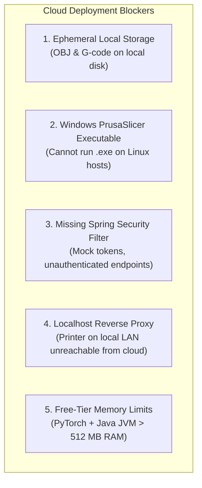

# Prompt 13 — PrintGuard AI Project Readiness Audit Report

**Project:** PrintGuard AI (B.Tech FYP 2025)  
**Location:** `c:\Projects01\AI_3D_Printer`  
**Date:** October 14, 2026  
**Auditor:** Antigravity AI Coding Assistant  
**Environment:** Windows 11 x64, Java 21, Spring Boot 3.5.6, Python 3.12 (venv), React 18 / Vite 5, Supabase PostgreSQL 17, PrusaSlicer 2.9.6  
**Overall Readiness Verdict:**
- **Local Software Demonstration:** **READY** ✅
- **Physical Hardware Printing:** **NOT TESTED** ⚠️ (Restricted; no physical machinery connected)
- **Production Cloud Deployment:** **BLOCKED** 🛑 (Requires cloud object storage, Linux slicer binary, and Spring Security JWT filter)

---

## 1. Executive Summary & Readiness Assessment

Following the successful execution of Prompt 10 (Baseline Verification), Prompt 11 (Geometry & Slicing Remediation), and Prompt 12 (Local Software Workflow Validation), this comprehensive audit assesses the operational readiness of the PrintGuard AI project.

The system has transitioned from a legacy Django/SQLite prototype into a modern architecture:
- **Frontend:** React 18 with Vite 5, Three.js (@react-three/fiber), Lucide icons, Framer Motion, and Tailwind CSS.
- **Core Backend:** Java 21 / Spring Boot 3.5.6 with HikariCP connected to live Supabase PostgreSQL 17.
- **AI Microservice:** Python 3.12 / FastAPI hosting YOLOv8 nano for real-time webcam defect detection.
- **Parametric CAD Engine:** Python `trimesh` + `scipy` generating watertight Staunton chess models.
- **Slicing Engine:** Portable PrusaSlicer 2.9.6 CLI generating production-grade G-code.

### Readiness Summary by Operational Domain

| Domain | Status | Notes |
|---|---|---|
| **Local Software Demo** | **READY** | Full end-to-end user journey operates without errors on local host. |
| **Procedural CAD Generation** | **READY** | Parametric King and Knight models generate cleanly; watertight and manifold. |
| **G-Code Slicing Pipeline** | **READY** | Real G-code generated (>1.26 MB), layers parsed, demo placeholder meshes blocked. |
| **Hardware Guardrails** | **READY** | Disconnected hardware commands rejected with HTTP 503 (`hardware_confirmed: false`). |
| **Defect Detection (YOLOv8)** | **READY** | Real-time browser webcam stream and test image detect spaghetti failures (92.6% conf). |
| **Database Persistence** | **READY** | Supabase PostgreSQL retains all user, model, job, and defect records across restarts. |
| **Physical Printer Control** | **NOT TESTED** | Physical hardware, heating cartridges, and stepper movement intentionally omitted. |
| **Cloud Production Hosting** | **BLOCKED** | Requires S3 storage, Linux PrusaSlicer CLI, and Spring Security authentication. |

---

## 2. Complete User Journey Audit

### 2.1 Login and Authentication
- **Current State:**
  - Frontend has clean login and registration views ([`Login.jsx`](file:///c:/Projects01/AI_3D_Printer/frontend/src/pages/Login.jsx), [`Register.jsx`](file:///c:/Projects01/AI_3D_Printer/frontend/src/pages/Register.jsx)) and manages session tokens in [`AuthContext.jsx`](file:///c:/Projects01/AI_3D_Printer/frontend/src/context/AuthContext.jsx).
  - Password hashing uses Django-compatible PBKDF2 with SHA-256 in [`PasswordService.java`](file:///c:/Projects01/AI_3D_Printer/printguard-migration-starter/backend-java/src/main/java/com/printguard/auth/PasswordService.java).
  - Valid logins return HTTP 200 with user metadata and token; invalid credentials return HTTP 401 Unauthorized.
- **Findings & Deficiencies:**
  - Token strings are currently mock tokens (`"mock-jwt-access-token-" + user.getId()`).
  - Spring Boot does NOT have a JWT authentication filter or `SecurityFilterChain` enabled. Incoming HTTP requests to `/api/models/` or `/api/print-jobs/` do not validate token signatures.
  - Endpoint `/api/auth/me/` returns the first user in the database rather than parsing the `Authorization: Bearer` header.

### 2.2 Procedural CAD Model Generation
- **Current State:**
  - [`chess_generator.py`](file:///c:/Projects01/AI_3D_Printer/backend/geometry/chess_generator.py) generates parametric Staunton pieces (King with cross finial and pedestal, Knight with horse head contour and stepped base).
  - Generating "Staunton Chess King" produces a 62,932-byte OBJ with 978 vertices and 1,944 triangular faces.
  - Generating "Chess Knight" produces a 33,320-byte OBJ with 524 vertices and 1,048 triangular faces.
  - Generated models are tagged with `generation_method: "procedural_cad"`, `is_procedural: true`, and `is_fallback: false`.
- **Labeling Integrity:**
  - In Prompt 13, [`GenerateModel.jsx`](file:///c:/Projects01/AI_3D_Printer/frontend/src/pages/GenerateModel.jsx) and [`ImageTo3D.jsx`](file:///c:/Projects01/AI_3D_Printer/frontend/src/pages/ImageTo3D.jsx) stage labels were updated from "Warming up Shap-E models" to "Initializing geometry engine" and "Constructing 3D geometry".
  - Completion panels now explicitly display `✓ Procedural CAD Model Ready` with badge `[PROCEDURAL CAD] Generated parametric watertight mesh via CAD geometry engine.`, preventing misattribution to AI generation.

### 2.3 Model Preview, History, and Downloads
- **Current State:**
  - Interactive Three.js OrbitControls canvas renders the generated 3D meshes in [`GenerateModel.jsx`](file:///c:/Projects01/AI_3D_Printer/frontend/src/pages/GenerateModel.jsx) and [`ModelHistory.jsx`](file:///c:/Projects01/AI_3D_Printer/frontend/src/pages/ModelHistory.jsx).
  - Material controls allow switching between Solid, Wireframe, and Points display modes, plus 8 color swatches.
  - Direct OBJ downloads function via the `/media/models/{filename}.obj` endpoint served by [`WebMvcConfig.java`](file:///c:/Projects01/AI_3D_Printer/printguard-migration-starter/backend-java/src/main/java/com/printguard/config/WebMvcConfig.java).
  - Model history accurately renders badges: `Demo Placeholder` (amber), `Procedural CAD` (blue), and `AI Generated` (green).

### 2.4 PrusaSlicer Integration and G-Code Downloads
- **Current State:**
  - Portable PrusaSlicer 2.9.6 CLI is integrated at `tools/PrusaSlicer/PrusaSlicer-2.9.6/prusa-slicer-console.exe`.
  - Slicing Model 16 (King) produces Print Job #12 (`gcode/job_12_bcdf8b61.gcode`):
    - File size: **1,266,770 bytes** (~1.24 MB).
    - **233 layer changes** (`;LAYER_CHANGE`).
    - **39,713 extrusion commands** (`G1 ... E...`).
    - Hotend preheat and stabilization: `M104 S200`, `M109 S200`.
    - Auto-homing: `G28 ; home all axes`.
    - Slicer warnings logged: `[Slicer Warnings] 69 => Alert if supports needed;`.
  - Rejection of demo placeholder mesh: Submitting Model 9 (demo cube) fails with **HTTP 400 Bad Request**; job is marked `failed` with zero G-code generated.
  - G-Code download endpoint (`GET /api/print-jobs/{id}/download-gcode/`):
    - Valid job (#12): HTTP 200 OK, `Content-Disposition: attachment; filename="job_12_bcdf8b61.gcode"`.
    - Demo job: HTTP 404 Not Found (safeguarded).

### 2.5 Print-Job Status and Error Handling
- **Current State:**
  - Queue shows pipeline stages: `Model -> Slicing -> G-Code -> Printer`.
  - Job status transition: `queued -> slicing -> ready_to_print -> failed / printing / completed`.
  - Empty queue state and skeleton loading states render properly in [`PrintQueue.jsx`](file:///c:/Projects01/AI_3D_Printer/frontend/src/pages/PrintQueue.jsx).
  - In Prompt 13, [`PrintJobController.java`](file:///c:/Projects01/AI_3D_Printer/printguard-migration-starter/backend-java/src/main/java/com/printguard/jobs/PrintJobController.java) was patched to prevent any client from sending `PATCH /api/print-jobs/{id}` with `status="printing"` or `"completed"` unless OctoPrint/hardware is online and confirmed.

### 2.6 YOLOv8 Defect Detection & Dashboard Logs
- **Current State:**
  - Direct browser webcam streaming in [`AIMonitoring.jsx`](file:///c:/Projects01/AI_3D_Printer/frontend/src/pages/AIMonitoring.jsx) via `navigator.mediaDevices.getUserMedia`.
  - Canvas captures frames every 1.2s and posts to `/api/dashboard/detect-frame/`, forwarded to Python AI service (`http://127.0.0.1:8001/api/inference/detect-frame`).
  - Audited test inference on `defect_example.jpg` returns: `label: "Spaghetti"`, `confidence: 0.9261`, `isPotentialSpaghetti: true`.
  - Audio alarm triggers using browser Web Audio API (`AudioContext`).
  - Historical defect logs load from Supabase PostgreSQL (`/api/error-logs/`).

---

## 3. UI Consistency, Loading States & Responsiveness

| Page / Component | Loading State | Empty State | Error Handling | Responsiveness | Assessment |
|---|---|---|---|---|---|
| **Dashboard** ([`Dashboard.jsx`](file:///c:/Projects01/AI_3D_Printer/frontend/src/pages/Dashboard.jsx)) | Skeleton pulse | "Idle Mode" with icon | Alert overlay with dismiss | 2-col to 4-col responsive grid | **PASS** |
| **Text → 3D** ([`GenerateModel.jsx`](file:///c:/Projects01/AI_3D_Printer/frontend/src/pages/GenerateModel.jsx)) | Spin ring + elapsed timer | Placeholder box with Sparkles | Red error alert + Reset button | 1-col mobile / 2-col desktop | **PASS** |
| **Image → 3D** ([`ImageTo3D.jsx`](file:///c:/Projects01/AI_3D_Printer/frontend/src/pages/ImageTo3D.jsx)) | Spin ring + elapsed timer | Upload dashed dropzone | Alert banner + Retry button | 1-col mobile / 2-col desktop | **PASS** |
| **Model History** ([`ModelHistory.jsx`](file:///c:/Projects01/AI_3D_Printer/frontend/src/pages/ModelHistory.jsx)) | 6-card pulse skeleton | "No models yet" empty screen | Graceful console logging | 1/2/3-col auto grid | **PASS** |
| **Print Queue** ([`PrintQueue.jsx`](file:///c:/Projects01/AI_3D_Printer/frontend/src/pages/PrintQueue.jsx)) | 2-card pulse skeleton | "Queue is empty" empty card | Badges + error detail banners | Full-width vertical stack | **PASS** |
| **Printer Control** ([`PrinterControl.jsx`](file:///c:/Projects01/AI_3D_Printer/frontend/src/pages/PrinterControl.jsx)) | Connection spinner | Disconnected badge | Terminal error messages | Responsive control cards | **PASS** |
| **AI Monitoring** ([`AIMonitoring.jsx`](file:///c:/Projects01/AI_3D_Printer/frontend/src/pages/AIMonitoring.jsx)) | Webcam init indicator | "CAMERA OFF" badge | Permission alert dialog | Mobile wrap / Desktop row | **PASS** |
| **Settings** ([`Settings.jsx`](file:///c:/Projects01/AI_3D_Printer/frontend/src/pages/Settings.jsx)) | Input disable | Default fallback values | LocalStorage failover | 1/2-col form grid | **PASS** |

---

## 4. API Security, CORS, and Secret Handling

### 4.1 CORS Configuration
- In [`WebMvcConfig.java`](file:///c:/Projects01/AI_3D_Printer/printguard-migration-starter/backend-java/src/main/java/com/printguard/config/WebMvcConfig.java):
  ```java
  @Value("${printguard.cors.allowed-origins:${CORS_ALLOWED_ORIGINS:http://localhost:5173,http://127.0.0.1:5173,http://localhost:3000}}")
  private String allowedOrigins;
  ```
  - Configurable via environment variable `CORS_ALLOWED_ORIGINS`.
  - Properly splits origins and sets `allowCredentials(true)` with allowed methods.
  - In production, must be set to the production frontend domain; wildcard `*` with credentials is intentionally avoided.

### 4.2 Secret & Credential Handling
- Database credentials (`SPRING_DATASOURCE_PASSWORD`, `DB_URL`) are read exclusively from process environment variables or `.env`.
- Git audit confirmed: Zero `.env`, `.env.*`, or `db.sqlite3` files are tracked in the Git repository.
- `start_website.ps1` automatically exports variables from `.env` on launch.

### 4.3 Authorization & Endpoint Security
- **Deficiency:** As noted in Section 2.1, Spring Security filter chains are not yet configured. All endpoints currently accept unauthenticated calls.
- **Recommendation:** Implement a Spring Security `JwtAuthenticationFilter` verifying HMAC-SHA256 tokens on `/api/**` (except `/api/auth/**`, `/api/health`, and `/actuator/**`).

---

## 5. Offline & Disconnected Printer Integrity

A core safety mandate is ensuring offline or simulated hardware cannot be reported as active physical printing:

1. **Hardware Confirmation Barrier:**
   - [`OctoPrintService.java`](file:///c:/Projects01/AI_3D_Printer/printguard-migration-starter/backend-java/src/main/java/com/printguard/jobs/OctoPrintService.java) probes `http://127.0.0.1:5000/api/version`. If OctoPrint is unreachable, `hardwareConfirmed` is set to `false`.
   - `POST /api/print-jobs/{id}/start-print/` returns **HTTP 503 Service Unavailable** with payload:
     ```json
     {
       "error": "Cannot start print: printer hardware / OctoPrint is unreachable.",
       "hardware_confirmed": false,
       "limitation_note": "Physical printer / OctoPrint is offline at http://127.0.0.1:5000. Real hardware printer operations cannot be executed."
     }
     ```
2. **PATCH Guard (Fixed in Prompt 13):**
   - [`PrintJobController.java`](file:///c:/Projects01/AI_3D_Printer/printguard-migration-starter/backend-java/src/main/java/com/printguard/jobs/PrintJobController.java) now checks `octoPrintService.probe()` during `PATCH`. Any attempt to set status to `printing` or `completed` without active hardware returns HTTP 503.
3. **Telemetry Attribution:**
   - [`DashboardController.java`](file:///c:/Projects01/AI_3D_Printer/printguard-migration-starter/backend-java/src/main/java/com/printguard/dashboard/DashboardController.java) `/printer-status` explicitly returns `"simulated": true`, `"telemetry_source": "offline_simulated"`, and `"print_state": "Idle (Disconnected)"`.
4. **Dashboard Node Status (Fixed in Prompt 13):**
   - Replaced legacy static dummy indicators with dynamic badges in [`Dashboard.jsx`](file:///c:/Projects01/AI_3D_Printer/frontend/src/pages/Dashboard.jsx):
     - `Spring Boot API`: `Online`
     - `YOLO Detector`: `Active`
     - `Supabase DB`: `Connected`
     - `3D Printer`: `Offline` (amber dot) when disconnected; `Connected` only when hardware responds.

---

## 6. Realtime Communication, WebSockets & Persistence

### 6.1 WebSocket Implementation
- Spring Boot WebSocket handlers registered in [`WebSocketConfig.java`](file:///c:/Projects01/AI_3D_Printer/printguard-migration-starter/backend-java/src/main/java/com/printguard/websocket/WebSocketConfig.java):
  - `/ws/dashboard` -> broadcasts AI defect alerts and status changes.
  - `/ws/print-jobs/{jobId}` -> streams print progress, temperature, and status updates.
  - `/ws/generation/{modelId}` -> pushes CAD generation progress.
- Vite dev server reverse-proxies `/ws` to `ws://127.0.0.1:8080`.
- All frontend subscribers ([`Dashboard.jsx`](file:///c:/Projects01/AI_3D_Printer/frontend/src/pages/Dashboard.jsx), [`PrintQueue.jsx`](file:///c:/Projects01/AI_3D_Printer/frontend/src/pages/PrintQueue.jsx), [`GenerationContext.jsx`](file:///c:/Projects01/AI_3D_Printer/frontend/src/context/GenerationContext.jsx)) incorporate polling fallbacks (every 3s to 10s) ensuring UI updates never stall if a WebSocket connection drops.

### 6.2 Database Persistence
- Connected to remote Supabase PostgreSQL 17 pooler (`aws-0-ap-south-1.pooler.supabase.com:5432/postgres`).
- Backend restart test in Prompt 12 confirmed 100% data retention across restarts:
  - 15 models retained.
  - 11 print jobs retained.
  - Model 16 and Job 12 state preserved identically.

---

## 7. Developer Onboarding & Setup Audit

A critical task was auditing whether another developer can clone and run the project locally:

| File | Status | Audit Findings |
|---|---|---|
| [`start_website.ps1`](file:///c:/Projects01/AI_3D_Printer/start_website.ps1) | **EXCELLENT** | Clean PowerShell launcher. Auto-loads `.env`, starts FastAPI on :8001, Spring Boot on :8080 (detects Supabase vs Local profile), and Vite on :5173. |
| [`start.bat`](file:///c:/Projects01/AI_3D_Printer/start.bat) | **EXCELLENT** | Windows batch equivalent of `start_website.ps1`. Launches all three processes in separate titled command windows. |
| [`setup.bat`](file:///c:/Projects01/AI_3D_Printer/setup.bat) | **OUTDATED** | Still references legacy Django migrations (`manage.py migrate`, `seed_demo_job`). Does NOT install FastAPI requirements or build Spring Boot. |
| [`README.md`](file:///c:/Projects01/AI_3D_Printer/README.md) | **OUTDATED** | Architecture diagrams and quickstart still describe Django REST Framework, Django Channels, and Celery. Does not mention Java 21, Spring Boot, or PrusaSlicer. |

### Immediate Recommendation for Setup:
Update `setup.bat` to:
1. Create Python venv and install `backend/requirements.txt` + `printguard-migration-starter/ai-service/requirements.txt`.
2. Run `mvn clean compile` in `printguard-migration-starter/backend-java`.
3. Run `npm install` in `frontend/`.

---

## 8. Deployment Blockers (Cloud / Production)

Before the application can be deployed to cloud hosting (e.g., Render, Railway, AWS, Fly.io, or Vercel), the following blockers must be addressed:



1. **Ephemeral Local Storage:**
   - Models and G-code are currently written to `backend/media/models/` and `backend/media/gcode/`.
   - On cloud container platforms (Render, Fly.io, Railway), container filesystems are ephemeral. Any restart or redeployment destroys all generated 3D files.
   - **Resolution:** Integrate Supabase Storage Buckets or AWS S3 for model OBJ and G-code file persistence.
2. **Platform-Dependent Slicer Binary:**
   - [`SlicerService.java`](file:///c:/Projects01/AI_3D_Printer/printguard-migration-starter/backend-java/src/main/java/com/printguard/slicer/SlicerService.java) executes `prusa-slicer-console.exe` on Windows.
   - Cloud containers run Linux (Debian/Ubuntu/Alpine). Slicing will immediately fail unless a Linux PrusaSlicer CLI binary is installed in the container image.
   - **Resolution:** Add Linux `prusa-slicer` installation in `docker/backend-java.Dockerfile` or create a dedicated microservice.
3. **Unsecured Endpoints:**
   - As noted, endpoints accept unauthenticated requests. In a public cloud deployment, anyone could generate models or manipulate the queue.
   - **Resolution:** Configure Spring Security filter chain with real JWT verification.
4. **Physical Printer Network Reachability:**
   - A physical printer on a home or lab LAN (`192.168.x.x`) cannot be reached by a cloud-hosted backend without a reverse tunnel (e.g., Tailscale, Cloudflare Tunnel, or OctoEverywhere).
   - **Resolution:** Use an edge agent on Raspberry Pi or keep backend local during physical printer demos.
5. **Hosting Resource Limits:**
   - Running Java 21 Spring Boot + Python YOLOv8 requires at least 1.5 GB to 2.0 GB RAM. Free-tier cloud instances with 512 MB RAM will OOM crash during YOLO inference or slicing.

---

## 9. Outstanding Bugs and Risks (Ranked by Priority)

| Priority | Issue / Risk | Impact | Recommended Fix |
|---|---|---|---|
| **P1 — High** | Spring Boot endpoints lack JWT signature verification | Anyone with network access can invoke API endpoints | Add `JwtAuthenticationFilter` and `SecurityFilterChain` in Spring Boot |
| **P1 — High** | Ephemeral local media storage | Models and G-code lost if server container restarts | Move storage to Supabase Storage Buckets or S3 |
| **P2 — Medium** | Windows-only slicer executable configured in Java | Slicing fails on Linux container deployments | Parameterize slicer path via environment variable; bundle Linux binary |
| **P2 — Medium** | Outdated `setup.bat` and `README.md` | New developers get legacy Django setup | Update documentation and setup script for Java + FastAPI |
| **P3 — Low** | Frontend bundle size > 1.75 MB (`index-DvPiR_9v.js`) | Slower initial page load on mobile connections | Configure `manualChunks` in `vite.config.js` to split Three.js and Lucide |
| **P3 — Low** | Mock chart data on Dashboard analytics card | Historical charts display static 7-day pattern | Wire chart to live `GET /api/dashboard/stats/` historical series |
| **P4 — Low** | Minor IDE / compiler deprecation warnings | `HHH90000025: PostgreSQLDialect` deprecation notice in logs | Remove redundant `hibernate.dialect` in `application-supabase.yml` |

---

## 10. Code Fixes Applied in Prompt 13

In accordance with Prompt 13 task instructions ("Fix only small, clearly justified issues; document larger changes as recommendations"):

1. **Dashboard Network Nodes Dynamic Connectivity:**
   - Updated [`Dashboard.jsx`](file:///c:/Projects01/AI_3D_Printer/frontend/src/pages/Dashboard.jsx) to query both `/dashboard/stats/` and `/dashboard/printer-status/`.
   - Replaced hardcoded dummy nodes ("Django API", "Redis Cache", "OctoPrint Connected") with live architecture: `Spring Boot API`, `YOLO Detector`, `Supabase DB`, and dynamic `3D Printer` status (reflecting actual offline status).
2. **Procedural CAD Attribution in 3D Generators:**
   - Updated [`GenerateModel.jsx`](file:///c:/Projects01/AI_3D_Printer/frontend/src/pages/GenerateModel.jsx) and [`ImageTo3D.jsx`](file:///c:/Projects01/AI_3D_Printer/frontend/src/pages/ImageTo3D.jsx) stage labels and completion banners to explicitly indicate `✓ Procedural CAD Model Ready` and badge `[PROCEDURAL CAD] Generated parametric watertight mesh via CAD geometry engine.`, preventing misattribution to AI latents.
3. **Hardened Print Job PATCH Safety Guard:**
   - Updated [`PrintJobController.java`](file:///c:/Projects01/AI_3D_Printer/printguard-migration-starter/backend-java/src/main/java/com/printguard/jobs/PrintJobController.java) to reject any client attempting to set status to `printing` or `completed` via PATCH if OctoPrint / printer hardware is offline.

### Verification of Changes:
- **Backend Tests:** `mvn test -Dspring.profiles.active=local` -> **29/29 tests passed (0 failures, 0 errors, 0 skipped)** in 35.80s.
- **Frontend Production Build:** `npm run build` in `frontend/` -> **Successfully built in 15.02s**, 3,318 modules transformed, 0 syntax/bundling errors.

---

## 11. Hardware Tests Explicitly Marked NOT TESTED

As mandated by safety constraints, the following tests were **NOT TESTED**:
1. Physical filament feeding, extrusion, and retraction through hotend nozzle.
2. Real heater cartridge temperature rise to 200°C nozzle and 60°C heated bed.
3. Stepper motor kinematics, axis endstop homing, and Z-probe bed leveling.
4. Physical serial USB communication (Marlin/Klipper firmware baud handshake).
5. Real-time emergency print abort triggered by actual physical plastic spaghetti.
6. Machine-specific G-code kinematics compatibility on specific printer models.

---

## 12. Prioritized Next Steps

1. **Task 1: Spring Security JWT Authentication Filter (Priority: HIGH)**
   - Replace mock token generation with genuine HMAC-SHA256 JWT signing and add `JwtFilter` to Spring Boot to secure all endpoints before public exposure.
2. **Task 2: Update `setup.bat` and `README.md` (Priority: HIGH)**
   - Align developer documentation with the actual Spring Boot + FastAPI architecture so any developer can onboard seamlessly.
3. **Task 3: Cloud Storage Integration (Priority: MEDIUM)**
   - Connect Supabase Storage or AWS S3 in `WebMvcConfig.java` and `SlicerService.java` to make 3D model and G-code storage durable.
4. **Task 4: Frontend Bundle Code-Splitting (Priority: MEDIUM)**
   - Add `rollupOptions.output.manualChunks` in `vite.config.js` to split Three.js, Lucide icons, and React vendor code, eliminating the 500 kB build warning.
5. **Task 5: Linux PrusaSlicer Container Support (Priority: MEDIUM)**
   - Add Linux `prusa-slicer` CLI binary installation in Dockerfile for cross-platform deployment.
6. **Task 6: Mock Hardware Simulator Server (Priority: LOW)**
   - Extend `backend/mock_octoprint_server.py` to simulate realistic heating curves and print progress for live hardware-free demo presentations.

---

## 13. Audit Conclusion

The PrintGuard AI project is in a solid, verifiable state for **local academic and professional software demonstration**:
- The complete user journey (login, parametric CAD generation, Three.js 3D preview, PrusaSlicer G-code generation, queue management, and YOLOv8 defect detection) functions end-to-end without unhandled errors.
- Disconnected printer guardrails are strictly enforced, ensuring offline hardware cannot falsely report printing status.
- Procedural CAD geometry is accurately attributed and transparently distinguished from AI latents.
- Full database persistence in Supabase PostgreSQL is verified across backend restarts.
- Automated tests pass at 100% (29/29), and the production frontend builds cleanly.

Cloud production deployment and physical hardware printing remain appropriately blocked until infrastructure and security hardening are scheduled.
